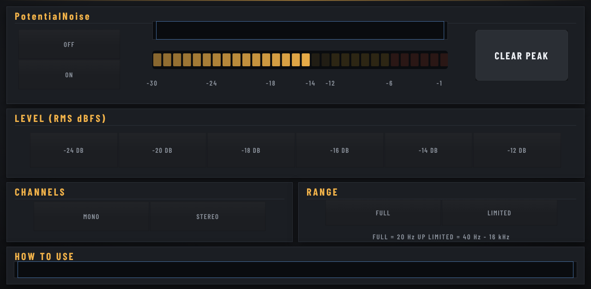

# PotentialNoise

**Mix against the noise.** A calibrated pink noise reference for the pink-noise mixing method: set a level, solo each track, and raise it until it's only just audible over the noise. A quick, neutral way to a balanced rough mix.

*Instrument plugin · MPC OS 3.x · Gen1 (32-bit) · v2.0.0*

Free and open source (MIT), made by **PotentialBreaks**. It runs inside the MPC like its own instruments, with its own touchscreen page, Q-Link control and project recall, and no computer needed while you play.

**[Download the latest release](../../releases/latest)** · [Install guide](INSTALL-GUIDE.md) · [FAQ](FAQ.md) · [Ideas and bugs](../../issues/new/choose)

## What it does

- **NOISE ON / OFF.** It starts off, so nothing blasts when you add it. Switching on, off or changing level fades over about 20 ms, so there are no clicks.
- **LEVEL:** one tap for **-24, -20, -18, -16, -14 or -12 dB RMS**. The level is measured, not guessed: -14 dB means -14 dBFS RMS.
- **CHANNELS:** **MONO** (the same noise in both speakers) or **STEREO** (two unrelated noise signals).
- **RANGE:** **FULL** (20 Hz and up) or **LIMITED** (40 Hz to 16 kHz, like the band-limited pink noise files many engineers use).
- **Reading and meter:** the live **RMS** and **PEAK** of what it's sending, and a 30-segment meter (1 dB per segment, -30 to -1 dB). **CLEAR PEAK** resets the peak.
- **HOW TO USE** reminds you of the method right on the page.

## The pink-noise method

1. Add PotentialNoise to a track and pick a level (-14 dB is a good start).
2. Tap **ON**.
3. Solo each of your tracks with the noise playing, and raise its level until you can **only just hear it** over the noise.
4. Switch the noise off. You have a balanced starting point for your mix.

Pink noise has equal energy in every octave, which is close to how we hear, so nothing ends up too loud or too quiet for its frequency range.

## Limitations

- **It's a starting point, not a finished mix.** Use your ears from there.
- **At -12 dB RMS the loudest noise peaks come close to 0 dBFS.** They are rounded off just below it rather than clipping. -14 dB or lower leaves headroom.
- **The meter shows the plugin's own output**, not your mix.
- **Tested on an MPC One only**, and on Gen1 hardware only.

## Coming from Pink Noise?

PotentialNoise is the renamed and re-styled **Pink Noise** plugin (same job, rewritten engine). It's a separate plugin as far as the MPC is concerned, so you can remove the old Pink Noise. Projects that used Pink Noise need PotentialNoise added instead.

## Will it work on my MPC?

| | |
|---|---|
| **Tested on** | MPC One (first generation) with HAKAI 3.10 firmware |
| **Should work on** | Other first-generation (Gen1, 32-bit) standalone MPCs running **MPC OS 3.x**: One, Live, Live II, X |
| **Not yet** | Gen2 hardware (MPC One+, Live III, Key 37, XL and others): no build yet. **MPC OS 2.x**: not supported |
| **You need** | A way to install third-party plugins on your MPC (see below) |

The **Should work on** row is untested so far. If you try it on another model, please [tell me how it went](../../issues/new/choose).

## Install

**👉 [Step-by-step install guide](INSTALL-GUIDE.md)**: start here if it's your first plugin.

The short version:
1. Download `PotentialNoise-<version>-mpc-armv7.zip` from [**Releases**](../../releases) and leave it zipped.
2. Install it with the free **MPC Plugin Installer** from [Open MPC](https://open-mpc.github.io/): connect, drop the zip in, press Install. Or install over SSH (see the guide).
3. **Save your project first.** Installing restarts the MPC app.
4. Find **PotentialNoise** in the plugin (instrument) list.

Stuck? The [**FAQ**](FAQ.md) covers the common problems.

## Also good to know

- **Made by one person, tested on one MPC.** It works well for me, but you may hit something I haven't. Please tell me if you do.
- **Plugins must be allowed to run on your MPC.** Stock firmware doesn't load third-party plugins until it has been set up for them (see [Open MPC](https://open-mpc.github.io/)). After a firmware update, you may have to redo that setup.
- **No warranty.** It's free and comes as it is. Back up your projects.

## Ideas, bugs and criticism: all welcome

I make these for myself first, and I want them to be good for everyone else too, so **please tell me what you think**, including what you don't like.

- 💡 [Suggest a feature](../../issues/new?template=idea.yml)
- 🐛 [Report a bug](../../issues/new?template=bug.yml)

You don't need to be technical. Short messages are great. See [CONTRIBUTING.md](CONTRIBUTING.md) for more, including how to send code.

## More from PotentialBreaks

- **[PotentialBreaks](https://github.com/PotentialBreakfast/mpc-vst-potentialbreaks)**: Drum-break slicer: a random break from your library on 16 pads, chopped and tempo-matched.
- **[PotentialPatina](https://github.com/PotentialBreakfast/mpc-vst-potentialpatina)**: Retro-colour insert effect: vinyl and tape noise, wobble, drive, bit-crush, tone and room in one box.
- **[PotentialWax](https://github.com/PotentialBreakfast/mpc-vst-potentialwax)**: Melodic sampler: pick or dig a song from your library, 16 cues found for you, matched to your tempo and key.
- **[PotentialPunch](https://github.com/PotentialBreakfast/mpc-vst-potentialpunch)**: Transient shaper: more or less punch and tail on drums and anything else, with one-tap presets.
- **[PotentialHeat](https://github.com/PotentialBreakfast/mpc-vst-potentialheat)**: Soft clipper and bus saturator: warmth, glue and loudness without clipping, with one-tap presets.
- **[MPC TOOLS](https://github.com/PotentialBreakfast/mpc-tools)**: a free second-screen app for Windows: your MPC's screen live on your PC (and in OBS), file transfer, your PC's folders on the MPC, and one-click "save the last 60 seconds".

## Build it yourself

See [BUILD.md](BUILD.md).

## Credits

- Built on **[mpc-vst-plugins](https://github.com/sd88me/mpc-vst-plugins)** by sd88me (MIT), the open kit that makes MPC plugins possible: the plugin wrapper, skin builder and installer.
- Fonts: **Barlow** and **Barlow Condensed** by Jeremy Tribby (SIL Open Font License 1.1), in `vst/skin/fonts/`.
- The dark look grew out of the theme I made for sd88me's Lucky Dip.
- Made with help from Claude (Anthropic).

Not affiliated with or endorsed by Akai Professional or inMusic. MPC is their trademark.

## Licence

[MIT](LICENSE): free to use, change and share, including in your own projects. Third-party parts keep their own licences ([THIRD_PARTY.md](THIRD_PARTY.md)).
